# ambientCG: Wood materials

**27 assets from [ambientCG](https://ambientcg.com), dedicated to the public domain under [CC0](https://docs.ambientcg.com/license/).** Use them in any game, free or paid, and change them however you like; no credit is needed.

PBR materials as 1K and 2K JPG maps (colour, normal GL and DX, roughness, AO, displacement), one folder per resolution. 890.0 MB in all.

This is a copy kept by [zuujis-cc0](https://github.com/zuujis-cc0) so game makers can take single files from GitHub. It is not made by or affiliated with ambientCG: the originals, often in more formats and higher resolutions, are on [ambientcg.com](https://ambientcg.com). If they help you, consider [supporting ambientCG](https://www.patreon.com/ambientCG).

Every file is listed in [MANIFEST.tsv](MANIFEST.tsv) with its size and SHA-256. More free assets: [the Zuujis collection](https://github.com/zuujis-cc0/free-game-assets#readme).

| | | | |
| :-: | :-: | :-: | :-: |
| <a href="Wood035">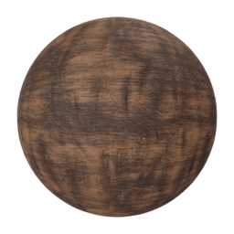</a> <b><a href="Wood035">Wood 035</a></b> by ambientCG · <a href="https://ambientcg.com/a/Wood035">source</a> | <a href="Wood036">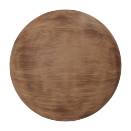</a> <b><a href="Wood036">Wood 036</a></b> by ambientCG · <a href="https://ambientcg.com/a/Wood036">source</a> | <a href="Wood037">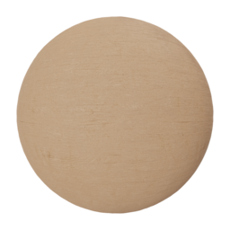</a> <b><a href="Wood037">Wood 037</a></b> by ambientCG · <a href="https://ambientcg.com/a/Wood037">source</a> | <a href="Wood038">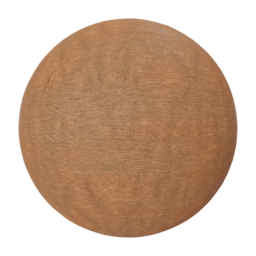</a> <b><a href="Wood038">Wood 038</a></b> by ambientCG · <a href="https://ambientcg.com/a/Wood038">source</a> |
| <a href="Wood039">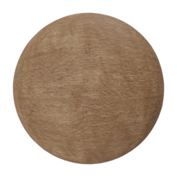</a> <b><a href="Wood039">Wood 039</a></b> by ambientCG · <a href="https://ambientcg.com/a/Wood039">source</a> | <a href="Wood040">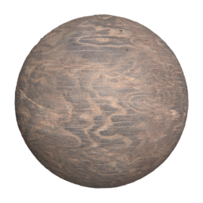</a> <b><a href="Wood040">Wood 040</a></b> by ambientCG · <a href="https://ambientcg.com/a/Wood040">source</a> | <a href="Wood041">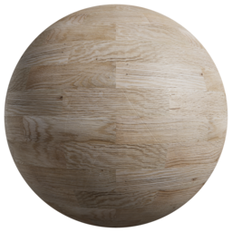</a> <b><a href="Wood041">Wood 041</a></b> by ambientCG · <a href="https://ambientcg.com/a/Wood041">source</a> | <a href="Wood042">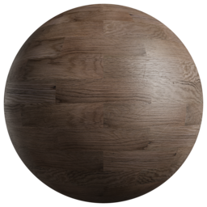</a> <b><a href="Wood042">Wood 042</a></b> by ambientCG · <a href="https://ambientcg.com/a/Wood042">source</a> |
| <a href="Wood043">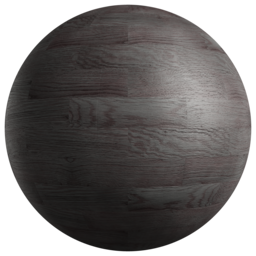</a> <b><a href="Wood043">Wood 043</a></b> by ambientCG · <a href="https://ambientcg.com/a/Wood043">source</a> | <a href="Wood044">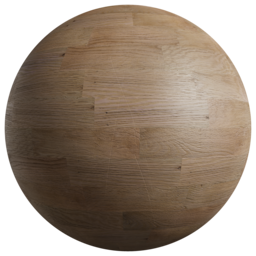</a> <b><a href="Wood044">Wood 044</a></b> by ambientCG · <a href="https://ambientcg.com/a/Wood044">source</a> | <a href="Wood045">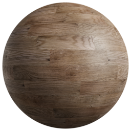</a> <b><a href="Wood045">Wood 045</a></b> by ambientCG · <a href="https://ambientcg.com/a/Wood045">source</a> | <a href="Wood046">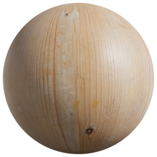</a> <b><a href="Wood046">Wood 046</a></b> by ambientCG · <a href="https://ambientcg.com/a/Wood046">source</a> |
| <a href="Wood047">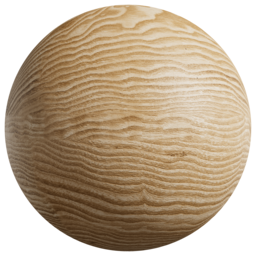</a> <b><a href="Wood047">Wood 047</a></b> by ambientCG · <a href="https://ambientcg.com/a/Wood047">source</a> | <a href="Wood048">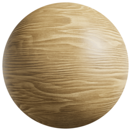</a> <b><a href="Wood048">Wood 048</a></b> by ambientCG · <a href="https://ambientcg.com/a/Wood048">source</a> | <a href="Wood049">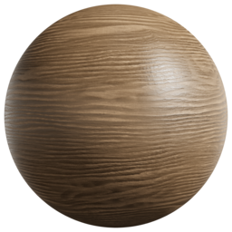</a> <b><a href="Wood049">Wood 049</a></b> by ambientCG · <a href="https://ambientcg.com/a/Wood049">source</a> | <a href="Wood050">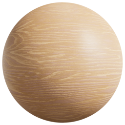</a> <b><a href="Wood050">Wood 050</a></b> by ambientCG · <a href="https://ambientcg.com/a/Wood050">source</a> |
| <a href="Wood051">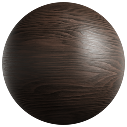</a> <b><a href="Wood051">Wood 051</a></b> by ambientCG · <a href="https://ambientcg.com/a/Wood051">source</a> | <a href="Wood052">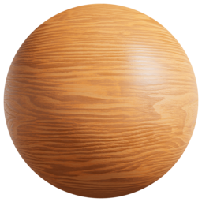</a> <b><a href="Wood052">Wood 052</a></b> by ambientCG · <a href="https://ambientcg.com/a/Wood052">source</a> | <a href="Wood053">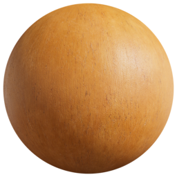</a> <b><a href="Wood053">Wood 053</a></b> by ambientCG · <a href="https://ambientcg.com/a/Wood053">source</a> | <a href="Wood054">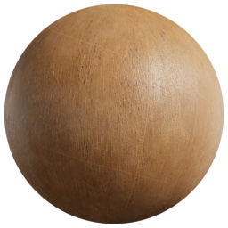</a> <b><a href="Wood054">Wood 054</a></b> by ambientCG · <a href="https://ambientcg.com/a/Wood054">source</a> |
| <a href="Wood055">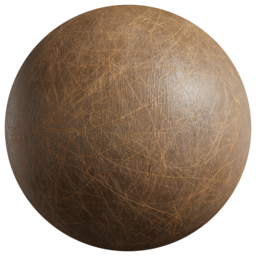</a> <b><a href="Wood055">Wood 055</a></b> by ambientCG · <a href="https://ambientcg.com/a/Wood055">source</a> | <a href="Wood056">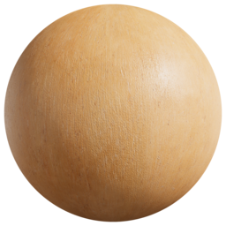</a> <b><a href="Wood056">Wood 056</a></b> by ambientCG · <a href="https://ambientcg.com/a/Wood056">source</a> | <a href="Wood057">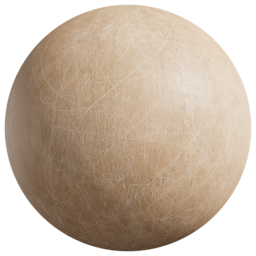</a> <b><a href="Wood057">Wood 057</a></b> by ambientCG · <a href="https://ambientcg.com/a/Wood057">source</a> | <a href="Wood058">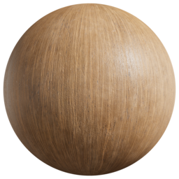</a> <b><a href="Wood058">Wood 058</a></b> by ambientCG · <a href="https://ambientcg.com/a/Wood058">source</a> |
| <a href="Wood059">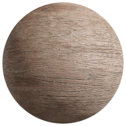</a> <b><a href="Wood059">Wood 059</a></b> by ambientCG · <a href="https://ambientcg.com/a/Wood059">source</a> | <a href="Wood060">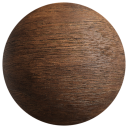</a> <b><a href="Wood060">Wood 060</a></b> by ambientCG · <a href="https://ambientcg.com/a/Wood060">source</a> | <a href="Wood061">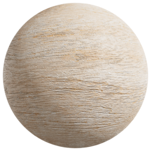</a> <b><a href="Wood061">Wood 061</a></b> by ambientCG · <a href="https://ambientcg.com/a/Wood061">source</a> |  |

---

Kept up to date by this repository's own [update workflow](.github/workflows/update.yml), with code and plan from [cc0-mirror](https://github.com/zuujis-cc0/cc0-mirror). Something wrong? [Open an issue there](https://github.com/zuujis-cc0/cc0-mirror/issues/new) or use the [private report form](https://games.zuujis.com/report).
